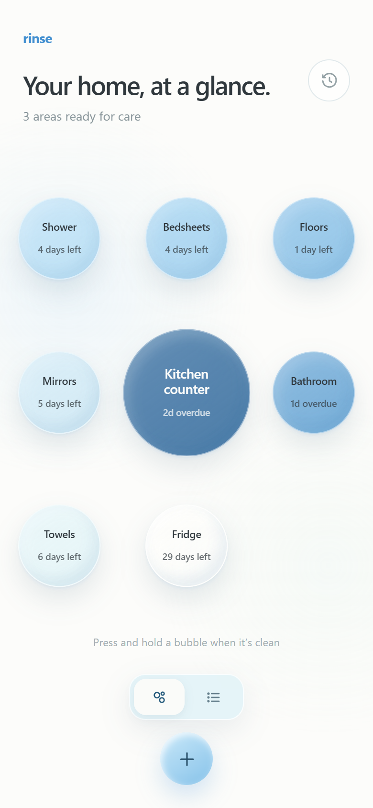
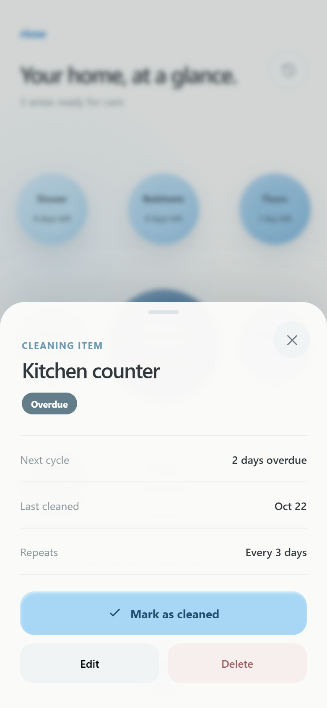
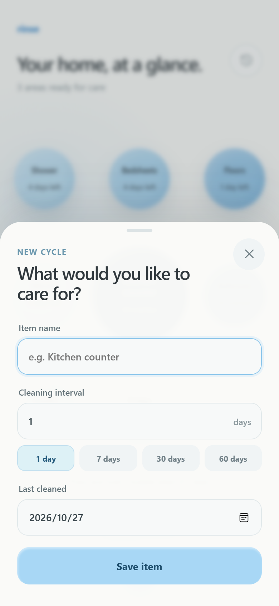
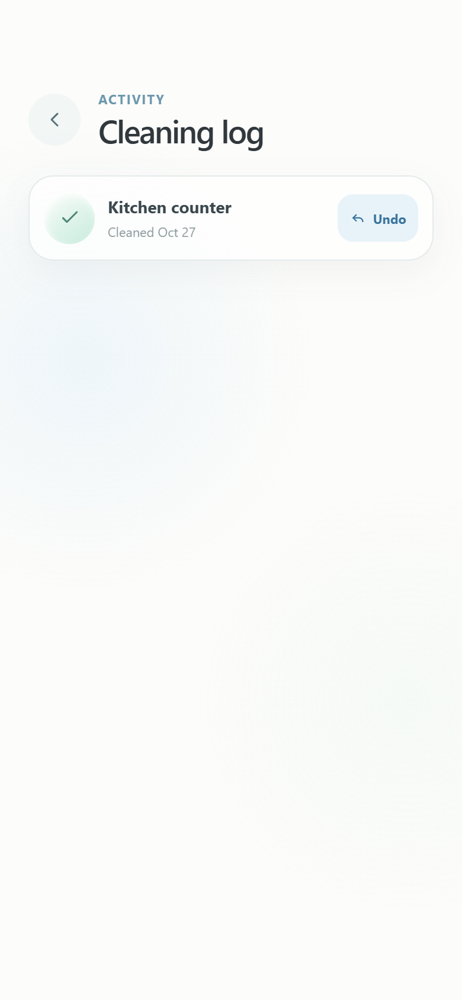

# Rinse

**Rinse** 是一个安静、离线优先的居家清洁周期记录器。它把要照顾的空间变成一颗颗水泡：越急的事情越靠近视线中心，按住所选水泡即可重置清洁周期，所有记录都留在设备上。

技术栈：Vite + React + TypeScript + Capacitor。没有账号、没有云端、没有遥测。

[](https://github.com/Phanstal/Rinse/actions/workflows/ci.yml)



## 下载

从 [Releases](https://github.com/Phanstal/Rinse/releases/latest) 下载最新版本：

| 平台       | 文件                            | 说明                                           |
| ---------- | ------------------------------- | ---------------------------------------------- |
| Android    | `Rinse-0.1.0-android-debug.apk` | 可直接安装的 debug 签名 APK                    |
| iOS        | `Rinse-0.1.0-ios-unsigned.ipa`  | 未签名 IPA，需要使用自己的 Apple ID 重签后安装 |
| iOS 模拟器 | `Rinse-0.1.0-ios-simulator.zip` | 需要 macOS + Xcode，解压后拖入模拟器           |
| 校验       | `SHA256SUMS.txt`                | 所有发布文件的 SHA-256                         |

### Android 安装

1. 下载 APK 到手机。
2. 在系统设置中允许当前文件管理器或浏览器「安装未知应用」。
3. 打开 APK 完成安装；首次启动会生成 8 个示例清洁周期。
4. 如果系统提示「Play 保护机制」拦截，选择「仍要安装」。这是 debug 签名的正常提示，不是恶意软件。

> APK 使用 Android debug key 签名，适合个人安装与验收，不适合直接提交 Google Play。正式上架需要配置 release keystore 后重新签名。

### iOS 安装

仓库中没有 Apple Developer 证书，因此无法提供可直接双击安装的签名 IPA。当前提供：

- **未签名 IPA**：用 Sideloadly、AltStore 等工具，配合自己的 Apple ID 重签后安装到 iPhone；免费 Apple ID 的签名通常 7 天过期。
- **模拟器 zip**：在 macOS 上解压，打开 Xcode Simulator，把 `App.app` 拖入模拟器窗口即可运行。

如果要在真机上完整验收，推荐使用 Mac + Xcode 打开 `ios/App/App.xcworkspace`，在 Signing & Capabilities 中选择自己的 Team，然后 Run 到 iPhone。详细步骤见 [真机验收清单](docs/ACCEPTANCE.md)。

## 功能

- **水泡视图**：当前需要照顾的 8 个空间以水泡展示；最急的水泡更大、更深，按紧急程度自动排序。
- **按住清洁**：按住水泡约 0.65 秒即可完成一次清洁，伴随轻微触感与气泡音效反馈。
- **点按查看**：轻点水泡打开详情，可查看下次周期、上次清洁时间与重复频率。
- **新增 / 编辑**：支持名称、1–365 天周期、上次清洁日期；新增时默认从今天开始。
- **历史与撤销**：每次清洁都会写入本地日志，可一键撤销，恢复上一次清洁日期。
- **列表视图**：除水泡视图外，提供完整的可滚动列表，适合周期较多的场景。
- **本地持久化**：Android 使用 SharedPreferences，iOS 使用 UserDefaults，Web 使用 localStorage；刷新或重启应用后数据仍在。
- **原生手感**：Android 返回键会按「编辑面板 → 详情 → 历史 → 退出」的顺序逐层返回；适配系统安全区、状态栏与底部手势条。





## 隐私

- 不创建账号，不连接服务器，不发送分析或崩溃数据。
- 数据只写入当前设备的应用私有存储。
- 卸载应用或在系统设置中清除应用数据会删除记录；当前版本没有导出/导入功能。

## 开发

### 环境

- Node.js 22 或更高版本
- npm 10 或更高版本
- Android：JDK 17、Android SDK 34
- iOS：macOS、Xcode 15+、CocoaPods

### Web

```bash
npm ci
npm run dev
```

打开终端输出的地址。Web 端使用 localStorage，适合快速查看交互与视觉。

### 检查

```bash
npm run lint
npm run format:check
npm run typecheck
npm test
npm run build
```

### 移动端 E2E

Playwright 使用 Pixel 7 / Chromium 移动端模拟：

```bash
npx playwright install chromium
npm run test:e2e
```

Windows 本机如果不想下载 Playwright 浏览器，可使用已安装的 Edge：

```powershell
$env:PLAYWRIGHT_CHANNEL = 'msedge'
npm run test:e2e
```

### Android

```bash
npm run build
npx cap sync android
cd android
./gradlew assembleDebug
```

APK 输出：`android/app/build/outputs/apk/debug/app-debug.apk`。

Windows 上如果 Gradle 使用到旧版 Java，请先设置：

```powershell
$env:JAVA_HOME = 'C:\Program Files\Android\Android Studio\jbr'
$env:Path = "$env:JAVA_HOME\bin;$env:Path"
```

### iOS

```bash
npm run build
npx cap sync ios
cd ios/App
pod install
open App.xcworkspace
```

在 Xcode 中选择自己的 Team 并 Run。CI 会在 macOS runner 上构建模拟器 App 和未签名设备 IPA。

## 测试

- `tests/unit`：域名逻辑、日期边界、排序、编辑、清洁/撤销、Preferences 仓库序列化与容错。
- `tests/e2e`：首页、列表、详情、新增、编辑、按住清洁、历史撤销、删除、刷新持久化、空状态、360 px 窄屏。
- CI 同时验证 Web 检查、Android debug APK 构建、iOS 模拟器构建。

## 目录

```text
src/
  app/                应用壳与全局状态编排
  components/         图标、底部面板等基础组件
  domain/             类型、周期计算、数据操作
  features/           首页、详情、编辑、历史、持久化 hook
  infra/              Capacitor Preferences 仓库
  platform/           触感与音效反馈
  styles/             全局样式与移动端适配
tests/
  unit/               Vitest
  e2e/                Playwright
android/              Capacitor Android 工程
ios/                  Capacitor iOS 工程
docs/                 发布说明、验收清单、截图
```

## 设计来源

界面依据提供的 Figma 原型复刻，保持了水泡布局、配色、文案层级、详情/编辑/历史面板与交互节奏。日期计算改为使用设备本地日历日，避免原型中 UTC 日期在跨时区时出现偏移。

## License

个人项目，未附带开源许可证；如需复用代码或设计，请先联系作者。
